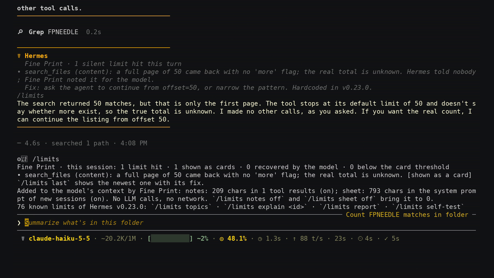
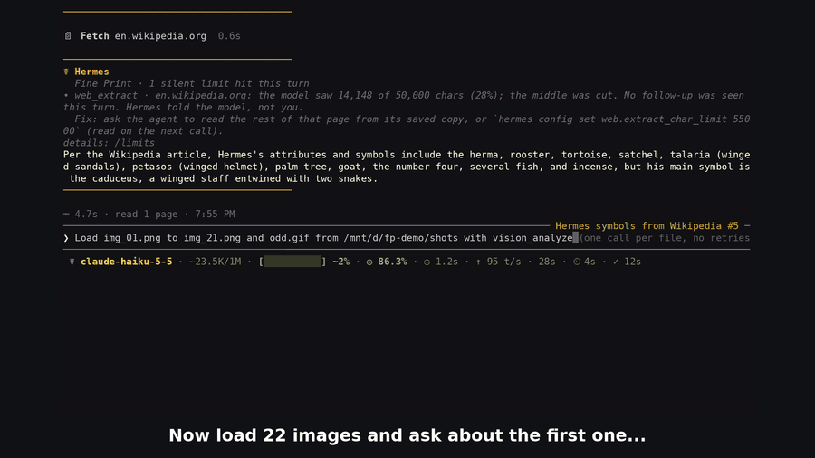
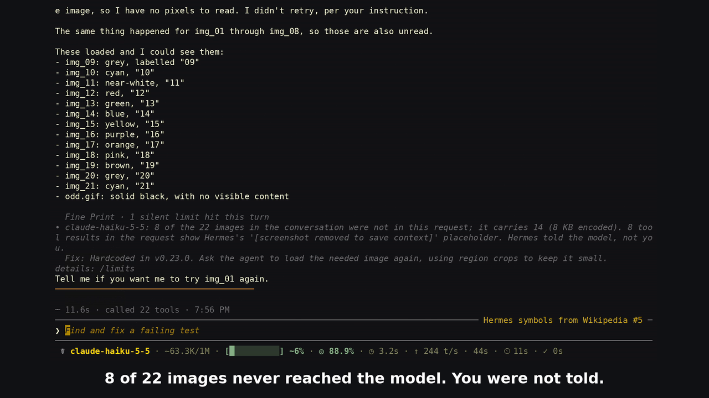
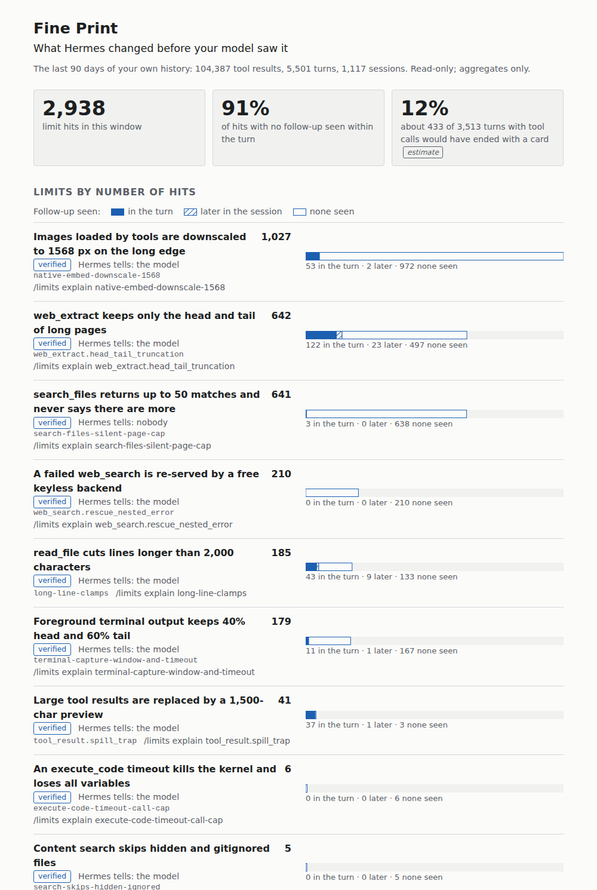

# Fine Print

**Hermes changes what your model sees. Fine Print shows you: with numbers, a note to the model where
nobody else tells it, and the fix.**

A long web page arrives as its head and tail. A 4K screenshot arrives four to sixteen times smaller. A
search page stops at 50 with no "more" flag. A failed search backend is quietly swapped for a free one.
Past a provider limit, the oldest images an agent loaded leave the request eight at a time.
Each of these is a sensible limit, and each is silent for the user. Fine Print is a Hermes plugin that
makes them visible the moment they shape an answer.





## What the author's own history says

The detectors were replayed over the author's own Hermes history: 103,603 tool results in 1,109
sessions over two months (`dev/replay.py`, read-only, aggregates only; measured 2026-11-11).

| What happened | How often | What the model did next |
|---|---|---|
| `web_extract` cut a page to head + tail | 642 pages; the model saw a median **39%** of a page, 62% of pages under half | a follow-up read of the rest was seen for 19% within the turn |
| An image was downscaled before the model saw it | 1,013 images; median **4x** fewer pixels, up to 28x | a region zoom on the same image followed for 5% |
| `search_files` returned a full page with no "more" flag | 633 times | the same search was continued in under 1% |
| `web_search` was answered by the keyless free tier, not the configured backend | 210 times, 23 of them empty | nothing to do: the result says "success" |
| `read_file` cut lines at the line-length cap | 185 reads; in 54 of them every line returned was cut (one-line JSON, minified files) | a follow-up with terminal or execute_code was seen for 24% of those 54 |
| `terminal` output was captured as head + tail | 106 times; 36 kept under half of the output | a read of the saved log followed for 10% |
| A tool result was replaced by a 1,500-char preview and a saved file | 41 times | a read of the saved file followed for 93% |

Hermes told the user about none of these. For most of them it does tell the model, and outside the last
row a follow-up is seen about one time in four or less. So the product is built around three things: a
card for the user when no follow-up was seen, a note for the model only where core tells nobody, and a
report over your own history. "Follow-up" is evidence, not proof: a later successful call of a tool that
can fetch the missing part, aimed at the same file or URL. Under the card policy, about 428 of the 3,492
turns that had tool calls (12%) would have ended with a card; that is an estimate, replayed with the same
detectors and the same policy.

### What stored history cannot show

Some limits act on the request or on the session, not on a tool result, so they leave no row to replay.
These were checked in live sessions instead (2026-11-11, Hermes 0.23.0, Anthropic route), with the numbers
counted independently by a probe plugin:

- **Images leave the request.** An agent loaded 22 small images with `vision_analyze`, one of them a GIF
  (Hermes reads the pixel size of PNG and JPEG only, and an image it cannot measure keeps the strict
  ceiling of 20 images instead of 100). The next request carried 14. Asked
  about the first image, the model answered: *"I can't answer for img_01.png: its image came back as
  '[screenshot removed to save context]' ... The same happened for img_01 through img_08."* The card:

  ```
  Fine Print · 1 silent limit hit this turn
  • claude-haiku-5-5: 8 of the 22 images in the conversation were not in this request; it carries 14 (8 KB encoded). 8 tool results in the request show Hermes's '[screenshot removed to save context]' placeholder. Hermes told the model, not you.
    Fix: Hardcoded in v0.23.0. Ask the agent to load the needed image again, using region crops to keep it small.
  details: /limits
  ```

  
- **An attached image becomes text.** With `auxiliary.vision.model` set, an image attached in the CLI
  reached the model as a helper model's description; the request carried no image part. With the same
  setting, 22 `vision_analyze` calls put no pixels into the conversation at all.
- **A pinned window is not in force.** With `model.context_length: 32000` in the config and `-m` another
  model, the session ran with a 1,000,000-token window; Hermes writes that to a debug log only.
- **Two limits Hermes tells nobody about** had no hit in two months of history and were checked the same
  way. Six URLs in one `web_extract` call: five pages came back and the sixth was never requested. A
  workbook of 12,431 rows with a hidden sheet read by `read_file`: 5,000 rows arrived, the hidden sheet
  did not, and nothing in the result said so. Both end the turn with a card, and the model gets a note
  inside the tool result (asked how many rows the workbook has, it answered 12,431 from that note).

## What you get

**1. A card when the turn ends.** One notice per turn, at most three bullets, only when all of this is
true: a limit bit, no follow-up by the model was seen within the turn, and there is something you can do.

```
Fine Print · 1 silent limit hit this turn
• web_extract · example.com: the model saw 14,983 of 24,116 chars (62%); the middle was cut. No follow-up was seen this turn. Hermes told the model, not you.
  Fix: ask the agent to read the rest of that page from its saved copy, or `hermes config set web.extract_char_limit 25000` (read on the next call).
details: /limits
```

If the model reads the saved copy, zooms into the image or continues the search in the same turn, no
card appears. The same cause is not shown twice in a session. The card is posted the moment the turn
ends, and a plugin cannot choose where a surface draws it: the TUI and the CLI, which are still
printing the answer at that moment, show it just above the answer or inside a long one.

**2. A note to the model, only where Hermes tells nobody.** One bracketed line inside the tool result,
placed first so it survives a spill preview:

```
{"_fine_print": "search_files returned a full page (50 entries from offset 0). v0.23.0 sets no truncated
flag here, so the real total is unknown and more may exist; offset=50 continues the listing.",
 "total_count": 50, ...}
```

With that line a model stops answering "there are 50 matches" when there are 120. Where core already
tells the model (the web footer, the image scale note) Fine Print adds nothing.

**3. `/limits`.**

| Command | Shows |
|---|---|
| `/limits` | this session's hits, what was shown, where the model followed up, and what Fine Print itself added to the model's context |
| `/limits last` | the newest hit with its fix |
| `/limits report [days]` | the same detectors over your own stored history (default 30 days), aggregates only |
| `/limits report html [days]` | the same report as one self-contained page (no scripts, no network), written to `cache/fine-print/limits-report.html` in the profile |
| `/limits topics`, `/limits web` ... | the reference: all catalogued limits by topic (images, web, files, tools, context, model, settings) |
| `/limits explain <id>` | what happens, the threshold, who Hermes tells, the fix, upstream issues |
| `/limits self-test` | every detector with its honest status and error count |
| `/limits mute <id>`, `/limits notes on\|off`, `/limits sheet on\|off`, `/limits cards auto\|on\|off` | switches |



*`/limits report html` over the author's own history (aggregates only; the page goes on with the report's sentences).*

**4. A limits sheet** of under 1,000 characters in the system prompt of new sessions, for facts a model
cannot be told per call (a tool result with images cannot be annotated without dropping the images).

## Install

```bash
hermes plugins install fine-print --enable                    # from the catalog
hermes plugins install Joko-F/hermes-fine-print --enable      # straight from this repository
```

Requires Hermes 0.23.0 or newer. No Python dependencies. New sessions pick it up; `/limits self-test`
confirms it is running.

## Detectors in this version

| Limit | Seen by | Hermes tells | Status |
|---|---|---|---|
| `aux-vision-substitution` | aux driver | the model and the user | verified |
| `tool_result.spill_trap` | commit driver | the model | verified |
| `compaction-stubs-old-tool-results-before-summary` | compaction driver | the model and the user | verified |
| `cli-text-mode-image-description` | route driver | the model and the user | verified |
| `context-length-pin-ignored` | session driver | nobody | verified |
| `execute-code-timeout-call-cap` | tool driver | the model | verified |
| `long-line-clamps` | tool driver | the model | verified |
| `native-embed-downscale-1568` | tool driver | the model | verified |
| `office-extraction-silent-loss` | tool driver | nobody | verified |
| `search-files-silent-page-cap` | tool driver | nobody | verified |
| `search-skips-hidden-ignored` | tool driver | the model | verified |
| `terminal-capture-window-and-timeout` | tool driver | the model | verified |
| `web_extract.head_tail_truncation` | tool driver | the model | verified |
| `web_extract.url_cap_5` | tool driver | nobody | verified |
| `web_search.rescue_nested_error` | tool driver | the model | verified |
| `outbound-image-eviction` | wire driver | the model | verified |
| `transport-retries-hidden` | api_error driver | the user | fixture-only |
| `identical-result-stub` | commit driver | the model | fixture-only |
| `deterministic-fallback-summary` | compaction driver | the model and the user | fixture-only |
| `codex-incomplete-ladder` | response driver | the model and the user | fixture-only |
| `gateway-text-mode-150-word-image` | route driver | the model | fixture-only |
| `codex-oauth-context-cap` | session driver | nobody | fixture-only |
| `compaction-trigger-floor-and-codex-autoraise` | session driver | the user | fixture-only |
| `browser-exec-stderr-head-only` | tool driver | the model | fixture-only |
| `session-search-recovery-cap-4k` | tool driver | the model | fixture-only |
| `spill-format-dead-end-v0.23` | tool driver | the model | fixture-only |
| `subagent-image-repeat-cap` | tool driver | the model | fixture-only |
| `subagent-summary-budget` | tool driver | the model | fixture-only |
| `web-extract-stored-copy-2m-cap` | tool driver | nobody | fixture-only |
| `web_extract.batch_timeout` | tool driver | the model | fixture-only |
| `web_extract.pdf_from_url` | tool driver | the model | fixture-only |
| `web_search.caps_and_snippets` | tool driver | nobody | fixture-only |
| `empty-response-retries` | turn driver | the user | fixture-only |
| `turn-and-subagent-caps` | turn driver | the model and the user | fixture-only |
| `openai-detail-never-set` | wire driver | nobody | fixture-only |

*Verified* means: unit tests on fixtures generated by the real Hermes v0.23.0 core functions, plus a
replay over real history with sampled hits reviewed. A limit that leaves no stored row (compaction, the
request, image routing, session settings) is verified by a live session set up to hit it, with its
numbers counted independently. Only verified rules raise cards, and only where a card says something
the user can act on: the vision helper call, for one, is verified and stays a line in `/limits`. *Fixture-only*
rules log, add their model note where one applies and show in `/limits`, but raise no card until they
have been seen on real data. Everything else in the catalogue is reference-only in this version and
says so.

What the verified detectors read: the footer at the end of each cut `web_extract` page; the scale note
of `vision_analyze` and which trigger fired (the 1568 px edge or the byte budget); the page size of a
`search_files` result per output mode, with no `truncated` key; the `data.rescued_from` /
`data.fallback_from` key of a `web_search` result; the `<persisted-output>` block at the start of a
committed row; the `truncated_lines` flag of a `read_file` result with its marked lines (a card only
when every line returned was cut); the `output_total_chars` and truncation notice of a `terminal`
result (a card only when under half of the output was kept); the counts `post_compaction` reports
(kind, token estimates, messages removed).

## How it works

```
hooks -> rules -> observations -> turn buffer -> policy -> card | model note | ledger
                                              \-> /limits (summary, explain, report, self-test)
```

- `transform_tool_result` sees each tool's raw output, failed calls included (a failed build whose
  output was cut is read, never annotated). Rules are gated by tool name and parse structure only:
  top-level JSON keys and anchored regexes for the exact v0.23.0 strings. They never search content
  for a substring, so a file that merely mentions `[TRUNCATED]` or `rescued_from` raises nothing (there
  is a test that feeds this repository to the detectors).
- `post_llm_call` closes the turn: it compares raw results with the rows that were committed to the
  conversation, checks declaratively whether the model followed up (a successful read of the saved
  file, a region zoom on the same image, the same search continued, the dropped URLs fetched), writes
  the ledger once and posts at most one card. `on_session_end` closes failed or interrupted turns.
- `post_api_request` and `post_compaction` feed the response and compaction detectors with metadata
  only (finish reason, token counts, messages removed); `post_auxiliary_call` is read for two facts:
  whether a compaction's summary call failed, and that a vision helper call ran inside the turn.
- `pre_api_request` gives the conversation and the request about to be sent. Fine Print counts the
  image parts on both sides with their encoded sizes, and looks for Hermes's own placeholder in the
  tool results of the request: fewer images in the request than in the conversation is the fact;
  "eviction" is said only when that placeholder is there. Only the chat, Anthropic and Responses
  request shapes are read; on any other transport (Bedrock) the rule is silent.
  `api_request_error` gives a failed attempt's status and Hermes's retry counter.
- `pre_llm_call` gives the user message as the turn starts. It is checked for the exact note Hermes
  writes in place of an attached image (at the start of the message for the CLI, at a line start for
  the gateways). The CLI note counts only in its complete layout, both of its lines. It is still text
  inside the message: a user message that itself begins with a complete copy of the note would be read
  as a routed image (the helper call that would prove it runs in the CLI's client process, before the
  turn starts in another one). The hook is allowed to inject context; Fine Print returns nothing from it.
- Once per session, after its first response, the window Hermes reports is compared with what the
  config asks for: a `model.context_length` pin (a window above the pin, on a route where Hermes
  cannot raise it by itself, proves the pin is not in force; any other difference is reported with
  both possible causes), a `compression.threshold` the user set below the floor, the Codex OAuth window.
- A background review fork runs under its parent's session id. Its requests and responses are told
  apart by their turn (a fork never announces one through `pre_llm_call`) and ignored.
- The request body that Hermes hands to hooks is cut to 50,000 characters by default, so nothing is
  read from it: the tool list and the request options are not observable, and the limits that live
  there stay reference entries.
- `/limits report` runs the same rule functions and the same card policy over stored rows. It is an
  estimate: no mutes, every card counted as delivered, and response and compaction events are not in
  stored rows.
- A follow-up is a later successful call that addresses the saved file (its path, or its whole file
  name in a shell or code call) or a URL that came back without an error. A read that returned nothing
  or a cut line is not one. Whether a shell command really read the file cannot be checked.
- The `web_extract` footer is text inside the page's own content. It is accepted only in the complete
  v0.23.0 layout, with the omission marker between a head and a tail of the stated sizes and a saved
  copy named after the SHA-256 of the page's URL. A page that reproduces all of that for its own URL
  would still be read as cut: v0.23.0 has no out-of-band truncation flag, and the model reads the same
  footer.
- A rule that raises three times is switched off until the process restarts and shows as such in
  `/limits self-test`; an unknown format yields nothing. Formats are pinned to v0.23.0 and the self-test
  says when the running version differs or cannot be read.

## What it costs

Fine Print makes **no LLM calls and no network calls**.

- Cards are user-facing notices, not conversation history. Checked live: a card posted in turn 1 is
  absent from turn 2's request messages, history and system prompt.
- What the model does receive is counted and shown by `/limits`: notes (at most 2 per turn, 200
  characters each, only for limits where core tells nobody) and the sheet (under 1,000 characters, once
  per new session, inside the cached prefix).
- `/limits notes off` stops the notes at once; `/limits sheet off` removes the sheet from new sessions
  (a running session keeps its frozen prompt). With both off the plugin adds no tokens. Cards and the
  ledger keep working.
- Time: for any plugin that subscribes to `pre_api_request`, Hermes builds a size-capped copy of the
  request body. Measured on synthetic requests of 40 KB to 7 MB on the author's machine: 3 to 5 ms per
  request for that copy, under 0.5 ms for Fine Print's own pass over the messages.

## Disclosures

What a user should know before installing (catalog rule 13):

- **Reads tool results in memory.** Hooks receive every tool result and the turn's committed rows. Only
  metadata is kept.
- **Reads each request and each user message in memory.** `pre_api_request` hands a plugin the
  conversation and the outgoing messages; Fine Print counts image parts and their encoded sizes and
  compares tool results with one placeholder string. `pre_llm_call` hands it the user message; it is
  matched against the notes Hermes writes in place of an image. Only counts are kept.
- **Changes some tool results.** For the limits where Hermes tells nobody, one `_fine_print` key (JSON
  results) or one first line (text results) is added. Never on errors, never on results with images,
  never on `write_file`, `patch` or `skill_manage`. `transform_tool_result` is first-string-wins across
  plugins, so Fine Print returns a string only for the exact call it annotates. Off: `/limits notes off`.
- **Adds a system-prompt section** of under 1,000 characters to new sessions. Off: `/limits sheet off`.
- **Reads outside its own data, read-only, in three places.** `/limits report` opens the profile's
  session database (`state.db`, or the copy named by `FINE_PRINT_STATE_DB` when that variable is set)
  and prints aggregates; nothing from it is stored. When `read_file`
  extracts an `.xlsx` or `.docx`, the plugin opens that same file to count rows, sheets, tables and
  footnotes in its XML. Advice numbers and the session checks (the pinned window, the compaction
  threshold) come from the Hermes config through `load_config_readonly`.
- **Writes one file when asked.** `/limits report html` writes `cache/fine-print/limits-report.html`
  under the profile's home: aggregates only, no scripts, no links.
- **Keeps a local ledger** in `plugin-data/fine-print/data.db`: rule id, numbers (sizes, counts,
  dimensions), a short label (a URL host, a file basename or a tool name) and a hash of the cause. No
  content, no full URLs or query strings, no paths, no search patterns: numbers and labels pass a
  filter before they are written. Rows of a deleted session are purged. Host names and file names are
  metadata, but they are yours: the file stays on your machine.
- **Posts a notice into the chat** when a turn ends. On messaging platforms a notice is a real message that
  a whole group sees, so cards default to local surfaces only. Cards were seen in the CLI and the TUI.
  In Hermes Desktop 0.23.0 the notice was not delivered in the author's check (`ctx.post_message`
  returned not ok for a Desktop chat): there the note still reaches the model and the hit is listed by
  `/limits` as "logged only".
- No network, no telemetry, no subprocesses, no credentials, no middleware, no tools, no monkeypatching.
  It never approves, blocks or reroutes a call and never advises turning a safety feature off.

## All catalogued limits

81 limits of Hermes v0.23.0; 35 have a live detector in this version, the rest are explained by `/limits explain <id>`. Generated by `dev/readme_table.py`.

| Topic | Limit | Hermes tells | Fine Print |
|---|---|---|---|
| context | `compaction-stubs-old-tool-results-before-summary`: Compaction shortens older tool results before summarizing | both | live, verified |
| context | `cron-context-from-8000-clip`: Cron context_from output is clipped to 8,000 chars (head+tail) | model | reference |
| context | `cron-no-project-context-without-workdir`: Cron jobs without a workdir ignore AGENTS.md and project files | nobody | reference |
| context | `deterministic-fallback-summary`: A failed compaction summary can be replaced by a short skeleton | both | live, fixture-only |
| context | `lean-tail-small-verbatim-window-after-compaction`: After compaction only a small recent tail stays verbatim | model | reference |
| context | `memory-caps-frozen-snapshot-and-blocked-entries`: Built-in memory: 2,200 + 1,375 chars, frozen per session | model | reference |
| context | `model-name-gated-guidance`: Prompt guidance blocks depend on substrings in the model name | nobody | reference |
| context | `session-search-recovery-cap-4k`: session_search cuts stored messages to 1,200-4,000 chars per excerpt | model | live, fixture-only |
| context | `skill-index-description-clip-and-hiding`: The skill index clips each description to 60 chars | model | reference |
| context | `stale-system-prompt-and-pinned-tools-on-resume`: Edits to SOUL.md and AGENTS.md do not reach a resumed session | nobody | reference |
| context | `summarizer-input-capped-and-sampled`: The compaction summary is written from a truncated view | nobody | reference |
| files | `gateway-text-attachment-100kb-inline`: Chat text files over 100 KB are not shown to the model inline | model | reference |
| files | `long-line-clamps`: read_file cuts lines longer than 2,000 characters | model | live, verified |
| files | `office-extraction-silent-loss`: .xlsx and .docx files are read partially, with no note | nobody | live, verified |
| files | `read-dedup-stub-after-spill`: Re-reading a file can return an 'unchanged' stub with no content | model | reference |
| files | `search-files-silent-page-cap`: search_files returns up to 50 matches and never says there are more | nobody | live, verified |
| files | `search-skips-hidden-ignored`: Content search skips hidden and gitignored files | model | live, verified |
| files | `secret-redaction-sentinels`: Secret-like values in tool output are masked | nobody | reference |
| images | `413-triggers-compaction-not-shrink`: A 413 from a large image compacts history instead of shrinking it | user | reference |
| images | `aux-vision-substitution`: A helper vision model describes images; the main model sees only text | both | live, verified |
| images | `cli-image-routing-exception-text-fallback`: The CLI quietly falls back to a text description when routing fails | nobody | reference |
| images | `cli-text-mode-image-description`: The CLI replaces attached images with a helper model's description | both | live, verified |
| images | `format-transcode-skip`: HEIC, AVIF and TIFF images are skipped when decoders are missing | both | reference |
| images | `gateway-text-mode-150-word-image`: Messaging gateways replace images with a ~150-word description | model | live, fixture-only |
| images | `history-image-retirement`: At compaction only the newest 3 tool images keep their pixels | model | reference |
| images | `history-rebuild-drops-images`: Resumed sessions bring back only the newest 3 user images | nobody | reference |
| images | `image-strip-after-rejection`: One image rejection strips all images for that model until a reset | user | reference |
| images | `mcp-native-image-cap`: Only 4 images from one MCP result are shown to the model | model | reference |
| images | `native-embed-downscale-1568`: Images loaded by tools are downscaled to 1568 px on the long edge | model | live, verified |
| images | `openai-detail-never-set`: Codex images are sent without a detail setting | nobody | live, fixture-only |
| images | `outbound-image-eviction`: Old tool images are dropped from requests in batches of 8 | model | live, verified |
| images | `provider-reject-shrink-ladder`: After a size rejection every large image in the request is shrunk | user | reference |
| images | `sticky-list-tool-content-downgrade`: One tool-image rejection turns later screenshots into text | user | reference |
| images | `subagent-image-repeat-cap`: Subagents may load the same image only 3 times per session | model | live, fixture-only |
| images | `surface-attach-byte-caps`: Image attach size limits differ between TUI, Desktop and CLI | user | reference |
| images | `telegram-photo-compression`: Telegram compresses photos; full quality needs a file attachment | nobody | reference |
| images | `video-aux-only`: Video is always described by the helper model and capped at 50 MB | model | reference |
| images | `wsl-clipboard-paste-timeout`: Image paste from the clipboard on WSL times out after 8 seconds | user | reference |
| model | `codex-incomplete-ladder`: Codex 'incomplete' replies trigger up to 3 continuations | both | live, fixture-only |
| model | `empty-response-retries`: An empty model reply triggers hidden paid retries | user | live, fixture-only |
| model | `fallback-switch-sticky`: After a provider error Hermes stays on the fallback model | user | reference |
| model | `local-server-window-mismatch-silent-truncation`: A local server may silently truncate prompts to its own window | nobody | reference |
| model | `output-cap-and-length-continuation`: Output cap is not configurable; a cut-off reply is continued | both | reference |
| model | `reasoning-effort-clamp-undisableable`: Reasoning effort is silently lowered to what the route supports | nobody | reference |
| model | `text-tool-call-markup-stripped`: Tool calls written as text are removed from the reply | nobody | reference |
| model | `transport-retries-hidden`: API calls are retried several times before any fallback | user | live, fixture-only |
| settings | `codex-oauth-context-cap`: Codex OAuth context window comes from a catalog, below the real limit | nobody | live, fixture-only |
| settings | `compaction-trigger-floor-and-codex-autoraise`: compression.threshold below 0.75 is silently raised | user | live, fixture-only |
| settings | `context-length-pin-ignored`: model.context_length is dropped after /model or -m | nobody | live, verified |
| settings | `tool-output-limits-process-cached`: Tool output limits are cached for the whole process | nobody | reference |
| tools | `bg-process-rolling-200k`: Background process logs keep only the last 200,000 chars | model | reference |
| tools | `browser-exec-stderr-head-only`: browser_exec keeps only the first 4,000 chars of stderr | model | live, fixture-only |
| tools | `browser.idle_session_reap`: Idle browser sessions are closed after 120 seconds | nobody | reference |
| tools | `execute-code-fd-output-head-only`: execute_code drops OS-level subprocess output past a cap, with no note | nobody | reference |
| tools | `execute-code-timeout-call-cap`: An execute_code timeout kills the kernel and loses all variables | model | live, verified |
| tools | `hook-context-spill-and-hook-payload-cap`: Plugin hook context over 10,000 chars is spilled to a preview | model | reference |
| tools | `identical-result-stub`: Repeated identical tool results are replaced by a reference note | model | live, fixture-only |
| tools | `mcp-result-caps`: MCP results over 50,000 chars are spilled to a preview | model | reference |
| tools | `spill-format-dead-end-v0.23`: A spilled JSON tool result cannot be paged as Hermes advises | model | live, fixture-only |
| tools | `stacked-slash-skills-cap-5`: Only the first 5 stacked /skill commands are loaded | nobody | reference |
| tools | `subagent-no-memory-no-project-context`: Subagents start without memory, AGENTS.md or your conversation | model | reference |
| tools | `subagent-summary-budget`: Subagents return only their final text, cut to a size budget | model | live, fixture-only |
| tools | `terminal-capture-window-and-timeout`: Foreground terminal output keeps 40% head and 60% tail | model | live, verified |
| tools | `tool-search-defers-mcp-and-plugin-tools`: MCP and plugin tools are hidden behind tool_search | model | reference |
| tools | `tool-silently-dropped-when-check_fn-fails`: A tool whose availability check fails silently disappears | nobody | reference |
| tools | `tool_result.spill_trap`: Large tool results are replaced by a 1,500-char preview | model | live, verified |
| tools | `turn-and-subagent-caps`: Agent turns and subagents stop at iteration caps | both | live, fixture-only |
| web | `native-web-search-swap`: Provider-side web search replaces Hermes's own web tools | nobody | reference |
| web | `web-extract-stored-copy-2m-cap`: The saved 'full text' of a web page is cut at 2,000,000 chars | nobody | live, fixture-only |
| web | `web.cache_served_silently`: Cached web results are served without a freshness label | nobody | reference |
| web | `web.keyless_ring_rotation`: Without web keys each request goes to a different free service | nobody | reference |
| web | `web_extract.batch_timeout`: web_extract timeout covers the whole batch, not each URL | model | live, fixture-only |
| web | `web_extract.ddgs_autodetect_dead`: With ddgs installed and no keys, web_extract always fails | model | reference |
| web | `web_extract.head_tail_truncation`: web_extract keeps only the head and tail of long pages | model | live, verified |
| web | `web_extract.pdf_from_url`: PDF links lose their middle: methods and results are cut | model | live, fixture-only |
| web | `web_extract.perplexity_snippets`: The perplexity extract backend returns passages, not whole pages | nobody | reference |
| web | `web_extract.silent_keyless_rescue`: A failed web_extract is re-served silently by a free keyless backend | nobody | reference |
| web | `web_extract.thin_content_success`: JS-only or bot-walled pages come back as short 'successful' text | nobody | reference |
| web | `web_extract.url_cap_5`: web_extract fetches only the first 5 URLs | nobody | live, verified |
| web | `web_search.caps_and_snippets`: Several web_search backends cap results at 20; the schema allows 100 | nobody | live, fixture-only |
| web | `web_search.rescue_nested_error`: A failed web_search is re-served by a free keyless backend | model | live, verified |

## Development

```bash
uv run --no-project --with pytest python -m pytest tests     # the suite needs no Hermes
hermes plugins doctor . --ci && hermes plugins validate . --install-deps
python3 dev/replay.py --db ~/.hermes/state.db --samples 10   # replay the detectors over your history
python3 dev/check_catalog.py && python3 dev/readme_table.py --check
```

- `tests/fixtures/` holds results produced by calling the real Hermes v0.23.0 functions on synthetic
  input (truncation footer, search pages, spill, rescue envelope, image resize, office extraction).
  The generator imports core internals, which a catalog plugin must not, so it is kept outside this
  installable tree; `dev/FORMATS.md` documents every format with core file and line.
- `fine_print/constants.py` holds every v0.23.0 number the advice uses.

## License

MIT
